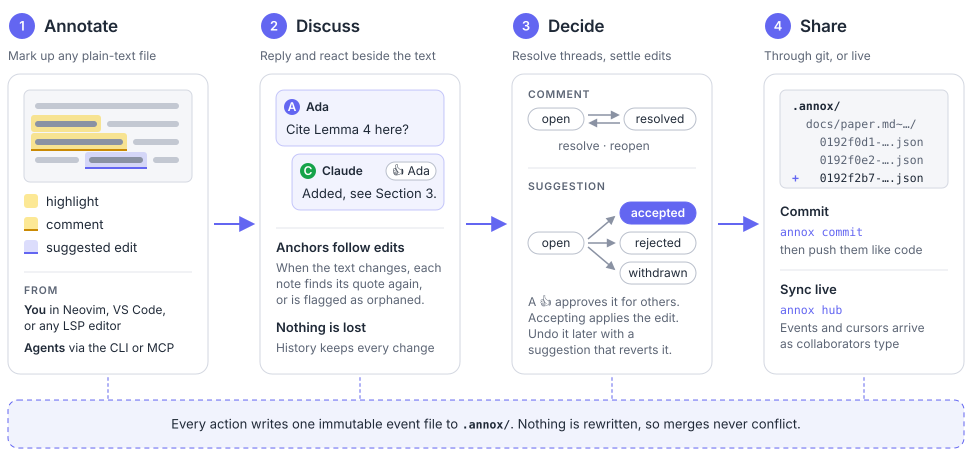
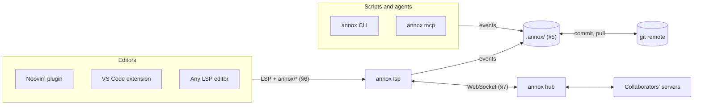

<p align="center">
  
</p>

<p align="center">
  <i>
    An open standard for portable document annotations — highlights, comments, and suggestions — that any editor can support.
  </i>
</p>

annox splits the problem the way LSP does: a portable **data format** that tools can read and write directly, and an optional **protocol** that lets editors talk to an annotation server instead of each editor integrating with each backend.

> [!WARNING]
> **Status:** spec version 0.1, a complete first draft. Expect incompatible changes before 1.0. See [`spec/`](spec/README.md) and the [changelog](spec/CHANGELOG.md).

## How it works

A review goes through four steps. Whoever acts, a person in an editor or an agent at the command line, each action writes one event file to `.annox/`.

<p align="center">
  
</p>

Here it is in Neovim: replying to a comment, commenting on a selection, accepting a suggestion, and suggesting edits as you type.

<p align="center">
  
</p>

To try it, [`examples/`](examples/) has a short proposal, already reviewed by two authors, with open, approved, resolved, accepted, rejected, and orphaned annotations, and a few reactions. Open `examples/proposal.md` in an editor with annox, or run `annox report --verbose` in that directory. [`proposal.annotated.pdf`](examples/proposal.annotated.pdf) is the proposal compiled to a PDF, with its open threads exported as PDF comments by `annox export-pdf`.

## Reference implementation

Editors talk to one server, and the CLI and agents work on the files directly:



A Rust reference implementation lives in [`crates/`](crates/). It covers every section:

| Spec           | Implemented in                             | Tested by                                        |
| -------------- | ------------------------------------------ | ------------------------------------------------ |
| §2 Data model  | `annox-core` (`event`, `replay`)           | replay vectors, reverse-order replay             |
| §3 Anchoring   | `annox-core` (`text`, `anchor`)            | anchoring vectors, worked example                |
| §4 Suggestions | `annox-core` (`suggestion`) and the server | suggestion vectors, accept/revert end-to-end     |
| §5 Storage     | `annox-core` (`storage`, `ops`)            | storage vectors, moves and publishing end-to-end |
| §6 Protocol    | `annox-lsp` (`annox lsp`)                  | in-process LSP tests, headless Neovim            |
| §7 Sync        | `annox-sync` (`annox hub`, replica)        | hub over WebSockets, two servers syncing         |

Crates:

- **`annox-core`** is the library. It covers normalization, anchoring (§3), suggestions (§4), event replay (§2), and storage (§5). Its conformance tests run every vector in [`spec/tests/`](spec/tests/).
- **`annox-sync`** has the sync hub and replica (§7).
- **`annox-lsp`** builds the `annox` binary. `annox lsp` runs the language server (§6) over stdio, and `annox hub` runs a sync hub.

Install the latest `annox` binary on Linux or macOS (Apple silicon) into `~/.local/bin`. Add `--skill` to also install the [agent skill](#agents) for Claude Code and other agents, and see `--help` for the version and directories. It verifies the download against the release's `SHA256SUMS`, and puts the man pages in `~/.local/share/man`, for `man annox` and `man annox-<command>`.

```sh
curl -fsSL https://gaardhus.github.io/annox/install.sh | sh
curl -fsSL https://gaardhus.github.io/annox/install.sh | sh -s -- --skill
```

On Windows, `install.ps1` does the same, and also adds `~\.local\bin` to your user `PATH` (unless you pass `-NoModifyPath`). See `-Help` for its options.

```powershell
powershell -ExecutionPolicy ByPass -c "irm https://gaardhus.github.io/annox/install.ps1 | iex"
powershell -ExecutionPolicy ByPass -c "& ([scriptblock]::Create((irm https://gaardhus.github.io/annox/install.ps1))) -Skill"
```

Later, `annox update` installs the newest release over the binary you run it from, and also updates the skill if it's installed. Pass `--version vX.Y.Z` to pick a release.

To build from source with `cargo build --release`, see [Contributing](#contributing).

The server implements:

- **For plain LSP editors (§6.5):** annotations as diagnostics, threads on hover, and code actions to accept or reject suggestions and to resolve or reopen threads.
- **For annox-aware plugins (§6.6):** every `annox/*` extension method. That covers creating, replying, editing, publishing local drafts, setting status, accepting and bulk-accepting, re-targeting, re-attaching, deleting and restoring, resolving conflicts (including reverting an accepted edit), moving documents, and history. It pushes `annox/didChangeAnnotations` after every change.

Edits always go through `workspace/applyEdit`, and the status event is written only once the editor confirms. The server picks up outside changes to `.annox/`, such as a `git pull`. It uses the editor's file watching where available, and otherwise checks every second. It offers to create a workspace when you add the first annotation outside one.

## Command line

The `annox` binary also reads and writes annotations directly. Text is targeted by quoting it, not by offsets, and an ambiguous quote is an error that lists where it occurs. Commands print text for people: `annox list` the threads under each document, with their ids, `annox report` a line per document (per author with `--by author`, broken down by status with `--verbose`), `annox history` a line per event, and the write commands what they did. With `--json`, every command prints JSON instead, for scripts and agents; set `ANNOX_OUTPUT=json`, or `"output": "json"` in [`config.json`](#configuration), to make that the default.

```sh
annox init [--local]
annox list [FILE] [--all | --closed] [--kind K] [--status S] [--mine | --others] [--broken] [--unread]
annox list paper.md --quote "the bound is tight"   # everything on that text, closed annotations too
annox show ID
annox history ID
annox log [FILE] [--follow]                         # every event, by anyone; -f prints new ones as they're written
annox report [FILE] [--verbose] [--by author,document] [--mine | --others] [--unread] ...
annox comment paper.md --quote "the bound is tight" --body "Cite Lemma 4?"
annox highlight paper.md --quote "the bound is tight"
annox suggest paper.md --quote "teh" --replace "the" --body "typo"
annox reply ID --body "Fixed."
annox status ID resolved
annox react ID 👍 [--remove]                        # 👍 on a suggestion approves it
annox accept ID
annox revert ID [--accept] [--body TEXT]
annox read ID... | --all
annox commit [-m TEXT] [--dry-run]
annox export-pdf paper.typ paper.pdf [-o OUT.pdf] [--closed] [filters]
annox import-pdf paper.typ reviewed.pdf [--dry-run] # comments made in a PDF viewer, back into annox
annox sync-pdf paper.typ paper.pdf [--watch]        # both, in the PDF itself; --watch keeps it in step
annox text paper.pdf                                # a file's text as annox reads it; for a PDF, its text layer
```

`annox list --unread` lists the threads others changed since you last read them, and every entry says whether it's `unread`. `annox read` marks threads read, and writing to a thread does too. What each author id has read is kept in the git-ignored `.annox/local/read.json`, so an agent with its own id (below) has its own unread list, and its reading doesn't mark anything read for you. `list --as ID` reads as another id.

Write commands use `--author`/`--name`, or `ANNOX_AUTHOR`/`ANNOX_AUTHOR_NAME`, and otherwise your [configured identity](#configuration). Give an agent its own id, for example `ANNOX_AUTHOR=urn:agent:claude`, so its annotations are distinguishable from yours. A running `annox lsp` picks up the changes, so they appear in the editor. Run `annox help` for every command.

`annox init` creates `.annox/` at the project root, which is meant to be committed so collaborators see the annotations. Every change is a new file there, so they add up between commits. `annox report` counts them, and `annox commit` commits just those files, with a message summarizing them, and leaves anything else you've staged alone. It doesn't push. `--dry-run` prints what it would commit. The editor plugins have the same command, which lets you edit the message first. To keep them to yourself, use `annox init --local`. It adds `*` to `.annox/.gitignore`, so git ignores the whole folder. To share them later, delete that line.

### Exporting to a PDF

`annox export-pdf FILE PDF` copies the open threads of a document into a PDF compiled from it, as ordinary PDF comments, for reviewers who read the PDF in any viewer and never see the source. It finds each quote in the PDF's text, so it works with Markdown, LaTeX, Typst, or anything else that compiles to a PDF with a text layer. Markup in quotes is ignored (`\emph{...}`, `#emph[...]`, link targets), and so are line breaks, hyphenation and ligatures. A quote that appears more than once is placed by its surrounding text. Comments become highlights, with their replies under them in the same note, as "Name, date: text". Replies as annotations of their own would be tidier in Acrobat, but Okular then won't open the comment, and browsers don't show them. A suggestion strikes out its text in red and writes the replacement above it in green, like a proofreader, with the words that change tinted on both sides, as the editors draw suggestions inline. Its note is just the reason for it, as the page shows the change, unless the replacement was too long to fit and was cut short. Acrobat lists the strikeout and the replacement as two comments: grouping them as its "replace text" edit would again stop Okular from opening the note. Each note has a closed popup, without which Firefox neither lists it among its comments nor lets you edit it. Threads it can't find, such as a comment on a LaTeX preamble or on text that's changed since the PDF was compiled, are listed on a page added at the end. It writes `NAME.annotated.pdf` next to the PDF unless given `-o`, and takes the filters of `annox list`. Each PDF comment carries its annotation's id as its name (`/NM`). Exporting into a PDF that annox exported into before replaces what it wrote there, so it never doubles up.

### Importing from a PDF

`annox import-pdf FILE PDF` goes the other way: it adds the comments reviewers made on a PDF in their viewer to the annotations of the document it was compiled from. Each mark is placed in the source by finding the PDF text it covers, as `export-pdf` finds quotes in the PDF. A highlight, underline or squiggly becomes a comment, with the note as its body, or a highlight if the note only repeats the text it covers, as Okular fills it in. Struck text becomes a suggestion to delete it, or with a caret grouped with it (Acrobat's "replace text") a suggestion to replace it with the caret's text. A caret alone is a suggestion to insert its text, a sticky note a comment on the word nearest to it, and a reply a reply, including replies to the comments `export-pdf` put there. Each keeps its author's name and its time. An author whose name is already in the workspace gets their id, and anyone else an id made from their name, as in `urn:annox:pdf:Jane%20Doe`. Comments that came from annox, and ones imported before, are left out, so you can import the same PDF again after the reviewer adds more. It prints what it added, and what it couldn't place, such as a comment on a page number. `--dry-run` only prints.

### Keeping a PDF in sync

`annox sync-pdf FILE PDF` does both in one step, in the PDF itself: it imports what reviewers added to the PDF in their viewer, then writes FILE's open threads into the PDF, replacing what it wrote before. Reviewers who don't use annox see the current threads, and what they add becomes threads. Their own comments are replaced by annox's copies once imported, so each shows up once. In a viewer that can't reply, such as Okular, a reviewer can answer by adding to the end of a comment's note: what they add becomes a reply, by whoever runs `sync-pdf` on that copy. Other changes to the notes annox writes aren't imported, and are listed as skipped.

With `--watch` it keeps running, and syncs again whenever FILE's threads change or the PDF is saved, printing what each sync did, or with `--json`, a line of JSON. If the workspace has a [hub](#live-sync), it syncs with it too, with no editor open, so threads others add anywhere show up in your PDF, and comments saved into your PDF reach everyone:

```sh
annox sync-pdf paper.pdf --watch
```

For both directions to work live, use a viewer that saves comments into the file and reloads it when it changes, such as Okular on Linux or SumatraPDF on Windows. Firefox and Chrome save a copy instead, so what reviewers add there only comes in when they save over the original. Acrobat saves into the file but doesn't reload it, and on Windows may keep it locked, in which case annox tries again until it can write.

### Annotating a PDF

A PDF can be annotated as it is, with no source. Its text is the text of its text layer, a line per line of text with a blank line between pages, which `annox text paper.pdf` prints: line numbers in `annox list` refer to it. Quotes match on letters and digits alone, so text copied from a PDF viewer is found whatever its line breaks and hyphens. Comments, suggestions and replies work as they do on any document, except that a suggestion can't be accepted, since annox doesn't change PDFs. `annox export-pdf paper.pdf` writes the threads into `paper.annotated.pdf`, `annox import-pdf paper.pdf reviewed.pdf` reads a reviewer's comments back, and `annox sync-pdf paper.pdf --watch` keeps the threads in `paper.pdf` itself. Editors can't open a PDF as text, so you annotate one from the command line or through an agent.

### Agents

[`harnesses/skills/annox/`](harnesses/skills/annox/SKILL.md) is a skill that teaches an agent the CLI and how to use it well: suggest instead of editing text you own, and answer comments in their threads. Install it with `install.sh --skill` (see [above](#reference-implementation)). That puts it in `~/.claude/skills` for Claude Code, and in `~/.agents/skills`, which Codex, Gemini CLI, Copilot CLI, Cursor, OpenCode, and pi read. Pass `--skill-dir DIR` to install it only in `DIR`. Or link it into your skills from a checkout:

```sh
ln -s "$PWD/harnesses/skills/annox" ~/.claude/skills/annox
ln -s "$PWD/harnesses/skills/annox" ~/.agents/skills/annox
```

For agents that can't run shell commands, `annox mcp` serves the same commands as MCP tools over stdio:

```sh
claude mcp add annox -- annox mcp --author urn:agent:claude --name Claude
```

It works on the directory it's started in, or the one given with `--root`.

#### Live: let the agent pick up threads as you write them

`annox watch` prints the threads others changed for you, as they change, each as `annox show` prints it, or with `--json`, one JSON line each: already unread ones first, then each new comment or reply once it has been unchanged for `--settle` milliseconds (default 2000). With `--mention @claude`, only threads that mention `@claude` or that the agent wrote in. Your own changes and threads you've marked read don't count, so an agent watching as itself never wakes itself up.

```sh
ANNOX_AUTHOR=urn:agent:claude annox watch --mention @claude
```

For a feed of everything that happens, by anyone, your own changes included, use `annox log --follow` (add `--json` for one JSON line per event). It doesn't use read state, so don't point an agent at it: it would see, and answer, its own replies.

Anything that can read lines can drive an agent with `annox watch --json`. In Claude Code, ask the agent to run that command with its Monitor tool and handle each thread as it arrives.

`annox mcp --channel` does the same through a [Claude Code channel](https://code.claude.com/docs/en/channels-reference): it pushes the threads into the running session, which handles them without being prompted. Channels are a research preview, so a custom one has to be loaded explicitly:

```sh
claude mcp add annox -- annox mcp --author urn:agent:claude --name Claude --channel --mention @claude
claude --dangerously-load-development-channels server:annox
```

Then comment `@claude …` in your editor and save. The agent reads files on disk, so it can't quote text you haven't saved yet. Its replies and suggestions appear in your editor as it writes them. Whoever can add annotations to the workspace can address the agent this way, collaborators through git or a sync hub included, so only use it in workspaces whose collaborators you trust with your session.

In [pi](https://pi.dev), the [annox extension](harnesses/pi/README.md) does the same: start pi with `--annox-watch=@pi`, or run `/annox-watch` in a session.

## Live sync

To share annotations live instead of only through git, run a hub and point the workspace at it:

```sh
annox hub --data ~/annox-hub --listen 127.0.0.1:7878 --token-file ~/.annox-hub-token
```

In `.annox/annox.json`, which is safe to commit:

```json
{ "format": 1, "sync": { "url": "wss://hub.example.org/w/my-paper" } }
```

Each user adds the hub to their [credentials file](#configuration), which is never committed:

```json
{ "hubs": { "wss://hub.example.org/w/my-paper": { "token": "…" } } }
```

The hub prints each connection as it opens and closes, and anything it refuses, to stderr. With `--verbose` it also prints the events each connection pushes, and their authors, but never what they say. The server syncs only with hubs listed there. Remote hubs must use `wss://`, and plain `ws://` is accepted only to localhost. The hub itself speaks plain WebSocket, so put it behind a TLS-terminating proxy to serve `wss://`. Sync and git work together. Events received from the hub are kept in the git-ignored `.annox/synced/`, so `git status` only lists the events you wrote, and pulling a collaborator's commit never collides with events that sync already delivered. Each person commits their own events. Collaborators' cursors appear in the editor as presence (§7.8). The hub doesn't implement read-only access yet.

## Editor support

- **Neovim:** [`editors/nvim/`](editors/nvim/README.md) is a plugin covering the full workflow: highlights, comments and suggestions, threads, accept and reject, suggestion mode, local drafts, re-targeting, conflict resolution, and history.
- **VS Code:** [`editors/vscode/`](editors/vscode/README.md) is an extension with the same workflow, showing annotations as native comment threads beside those of other providers. Each release attaches it as a `.vsix`.
- **Any other LSP editor:** point it at `annox lsp` for the plain-LSP features. It accepts `initializationOptions` of the form `{ "annox": { "author": { "id": "…", "name": "…" }, "diagnostics": true } }` (§6.2). Both are optional.

## Configuration

annox reads configuration from four places:

| Where                              | Scope                    | Settings                                                                                              |
| ---------------------------------- | ------------------------ | ----------------------------------------------------------------------------------------------------- |
| `.annox/annox.json`                | The workspace, committed | `format` and `sync.url`, the hub to sync with (see [Live sync](#live-sync))                           |
| `~/.config/annox/config.json`      | You, on every workspace  | `author`, your identity, and `output`, what the CLI prints                                            |
| `~/.config/annox/credentials.json` | You, never committed     | `hubs`, a token per hub URL (see [Live sync](#live-sync))                                             |
| Editor settings                    | One editor               | The LSP `initializationOptions` above, or the [Neovim plugin's options](editors/nvim/README.md#setup) |

The user files live under `$XDG_CONFIG_HOME/annox/` when it's set. `ANNOX_CONFIG_FILE` and `ANNOX_CREDENTIALS_FILE` point at a file elsewhere. A missing file is the same as an empty one.

`config.json` sets the identity your annotations are written as, and with `"output": "json"`, makes the CLI print JSON unless `ANNOX_OUTPUT=text` says otherwise:

```json
{ "author": { "id": "mailto:ada@example.org", "name": "Ada Lovelace" }, "output": "json" }
```

The identity is taken from the first of these that is set:

1. The command: `--author`/`--name` for the CLI and `annox mcp`, or the editor's `author` option for `annox lsp`.
2. `ANNOX_AUTHOR` and `ANNOX_AUTHOR_NAME`.
3. `author` in `config.json`.
4. Git's `user.email` and `user.name`, as `mailto:` plus the email.

A name alone only renames the identity from the next step down. An id without a name stands on its own, so an agent's `ANNOX_AUTHOR=urn:agent:claude` never picks up your name. If `config.json` is invalid, the CLI refuses to write, and `annox lsp` logs a warning and uses git's identity.

## Contributing

Contributions are welcome. [`CONTRIBUTING.md`](CONTRIBUTING.md) covers building and testing, changing the spec, and commit conventions. For anything bigger than a small fix, please open an issue first.
